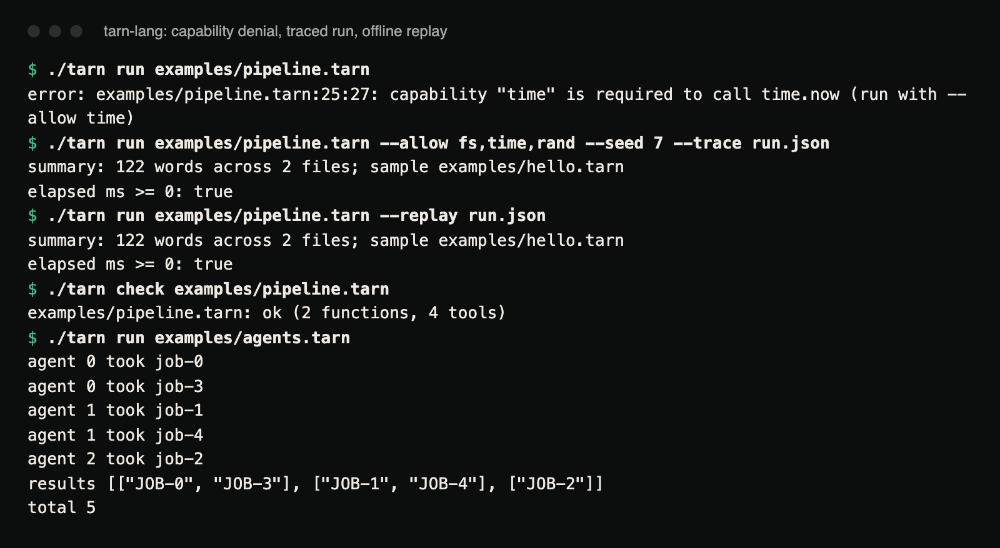

# Tarn

A small language for agent workflows. Every run is deterministic, every side
effect is a typed tool call that needs a capability flag, and every run can be
recorded and replayed without the outside world.

[Case study ↗](https://hellpuff.dev/work/tarn-lang)

```
tool http.get(url: Str) -> Str          // a typed tool; needs --allow http
tool fs.write(path: Str, body: Str)     // needs --allow fs

fn fetch(name: Str) -> Map[Any] {
    return parse_json(http.get("https://api.example.com/items/" + name))
}

fn main() {
    let tasks = map(["a", "b", "c"], fn(n: Str) -> Task[Map[Any]] { return spawn fetch(n) })
    let items = await tasks                    // tasks run in spawn order: no races, ever
    let report = join(map(items, fn(i: Map[Any]) -> Str { return str(i["title"]) }), "\n")
    fs.write("report.txt", report)
    print(len(items), "items")
}
```

```
$ tarn run flow.tarn
error: flow.tarn:5:31: capability "http" is required to call http.get (run with --allow http)

$ tarn run flow.tarn --allow http,fs --trace run.json
3 items

$ tarn run flow.tarn --replay run.json          # offline, no capabilities: identical output
3 items
```

`api.example.com` is a placeholder, so the two successful runs above were
checked by pointing the same program at a local HTTP server that returns
`{"title": ...}` for `/items/a`, `/items/b` and `/items/c`. The capability
error is exactly what the unmodified program prints.

Go, standard library only, about 3,500 non-blank lines of non-test code.
Commands: `tarn run | check | fmt | repl`.

## Demo

The bundled examples, run from a fresh clone after `go build -o tarn
./cmd/tarn` and `mkdir -p examples/out`:



Real terminal capture of the commands below. The replay needs no
`--allow` flags: `time.now`, `fs.read` and `rand.int` results come from
`run.json`.

```console
$ ./tarn run examples/pipeline.tarn
error: examples/pipeline.tarn:25:27: capability "time" is required to call time.now (run with --allow time)
$ ./tarn run examples/pipeline.tarn --allow fs,time,rand --seed 7 --trace run.json
summary: 122 words across 2 files; sample examples/hello.tarn
elapsed ms >= 0: true
$ ./tarn run examples/pipeline.tarn --replay run.json
summary: 122 words across 2 files; sample examples/hello.tarn
elapsed ms >= 0: true
$ ./tarn check examples/pipeline.tarn
examples/pipeline.tarn: ok (2 functions, 4 tools)
$ ./tarn run examples/agents.tarn
agent 0 took job-0
agent 0 took job-3
agent 1 took job-1
agent 1 took job-4
agent 2 took job-2
results [["JOB-0", "JOB-3"], ["JOB-1", "JOB-4"], ["JOB-2"]]
total 5
```

## What is it?

| Piece | What it does |
|---|---|
| **Language** | `Int`, `Str`, `Bool`, `Nil`, `List[T]`, `Map[T]`, `Fn(..) -> T`, `Task[T]`, first-class closures, `if`/`for`/`while`, modules via `import`, string/list/map builtins, higher-order `map`/`filter`/`reduce`. |
| **Gradual static checker** | Annotated parameters, returns and `let` types are enforced at compile time (arity, operand types, every-path returns, break outside loop, unknown names, module members). Unannotated code is `Any` and re-checked at run time where it meets a typed boundary. |
| **Tools** | `tool ns.name(params) -> T` binds a host function. Arguments and results are checked against the declaration; each namespace needs a capability (`--allow http,fs,env,time,rand,proc`) or the call fails with a message that tells you which. |
| **Tasks** | `spawn f(x)` creates a task, `await t` / `await [t1, t2]` collects. Tasks are cooperative and run in spawn order, so output is identical on every machine. `par_map` fans work out to goroutines: their tool calls (I/O) overlap, while the Tarn code itself runs one worker at a time under an interpreter lock, so shared variables cannot race. |
| **Trace and replay** | `--trace out.json` records every tool call (sequence, tool, args, result). `--replay in.json` serves those results back and refuses to continue if the program diverges from the recording. Replays need no capabilities. |
| **Determinism** | `time.now` and `rand.int` are tools too; `--seed` fixes the RNG; there is no other source of nondeterminism. Same program + same trace = same run. |
| **Tooling** | `tarn check` (diagnostics with `file:line:col`), `tarn fmt` (idempotent canonical formatter, `-w` to write, exit 3 in CI if it would change), `tarn repl`. |

## Who is it for?

- People building agent orchestration, ETL or automation scripts who want
  "why did it do that?" to have a reproducible answer.
- Anyone who wants a scripting language whose programs cannot touch the
  network or disk unless the operator allows it, per namespace, on the
  command line.
- People studying **language implementation**: lexer, parser, checker,
  interpreter, scheduler, formatter and module loader in one readable
  codebase with a test suite that pins semantics.

## Why does it exist?

Agent workflows are written today in general-purpose languages where every
library call can hit the network, every goroutine reorders output, and
reproducing an incident means re-running against a world that has moved on.
Tarn makes the three properties that matter for that job *language-level*:
side effects are explicit and gated, scheduling is deterministic, and runs
are recordable. It is a small language on purpose: the interesting part is
the runtime contract, not the syntax.

## What makes it different?

- **Capabilities on the command line, per tool namespace**, enforced at the
  call site with a message naming the missing flag.
- **Typed tool boundaries in both directions**: arguments are checked
  against the declaration before the host sees them, and the host's return
  value is checked against the declared type before the program sees it.
- **Replay that verifies**: a recording is not just data to feed back; the
  replayer checks that the program makes the same calls in the same order
  with the same arguments, so a changed program cannot silently misuse an
  old trace.
- **Deterministic tasks without locks**: cooperative FIFO scheduling means
  `spawn`/`await` are reasoning tools, not hazards. Spawned tasks that were
  never awaited are still drained at exit, so no side effect is lost.
- **Formatter and checker built on the same parser**, so `tarn fmt` is
  guaranteed idempotent and meaning-preserving (tested on every example).

## What the tests pin down

The runtime contract is tested: 18 static-error cases, runtime
errors with exact `line:col`, deterministic task output checked across 20
runs, capability denial, trace recording, seeded reproducibility, replay
equality, replay divergence detection, tool return-type enforcement, import
cycles, formatter idempotence over every example, a step limit that stops
`while true {}`, and an 8,000-program token-soup fuzz that must never panic, a parser nesting
limit against stack-exhaustion input, and `par_map` checked for data races,
step-limit enforcement and real tool-call overlap,
all under `go test -race`. CI runs the build, `go vet`, the race tests and
the example commands below on Ubuntu, Windows and macOS with Go 1.24, plus
`gofmt`, a stdlib-only/no-`unsafe` check and gitleaks.

## Build, test, run

```
go build -o tarn ./cmd/tarn
go test -race ./...
./tarn run examples/hello.tarn
./tarn run examples/agents.tarn
mkdir -p examples/out          # pipeline.tarn writes examples/out/summary.txt
./tarn run examples/pipeline.tarn --allow fs,time,rand --seed 7 --trace run.json
./tarn run examples/pipeline.tarn --replay run.json
./tarn check examples/agents.tarn && ./tarn fmt examples/agents.tarn
```

Go 1.24+. `tarn fmt` prints the formatted file and exits 3 when it differs
from the input (it does for `agents.tarn`: `fmt` drops its comments and
puts its inline closures on separate lines), so
the last line ends with exit status 3 rather than 0.

## Limits

- Tree-walking interpreter: fine for orchestration, wrong for number
  crunching (`examples/agents.tarn` runs in milliseconds; a recursive
  `fib(30)` takes about a second on an Apple M-series laptop).
- Gradual typing means `Any` flows through builtins like `parse_json`; the
  runtime checks catch mismatches at typed boundaries, not before.
- Cooperative tasks do not run in parallel. `par_map` overlaps tool calls
  only (Tarn code in its workers is serialised); its trace and print order
  follow completion order, so replaying a `par_map` run needs the same
  completion order.
- Replay stops a program that makes *more* or *different* calls than the
  trace, but does not fail a program that makes *fewer* calls.
- `parse_json` of a non-integer number yields a value Tarn cannot do
  arithmetic on (there are no floats).
- Expressions, blocks, types and `else if` chains may nest at most 1000
  levels deep.
- `tarn run` sets no step limit; `MaxSteps` is only available when
  embedding the interpreter as a Go package.
- No floats, no structs, no pattern matching, no exceptions beyond
  `error(msg)` unwinding to the caller of `await`/`main`.
- `tarn fmt` drops comments (it prints from the AST). Comment-preserving
  formatting is on the roadmap; until then use it on comment-free files or
  review the diff.

## Documentation

- [`docs/LANGUAGE.md`](docs/LANGUAGE.md): syntax, types, builtins, tools, tasks, tracing
- [`ARCHITECTURE.md`](ARCHITECTURE.md): checker, interpreter, scheduler, tool host, replay protocol
- [`docs/PRODUCTION_READINESS.md`](docs/PRODUCTION_READINESS.md): audit evidence, acceptance checklist
- [`SECURITY.md`](SECURITY.md), [`TESTING.md`](TESTING.md), [`ROADMAP.md`](ROADMAP.md), [`CONTRIBUTING.md`](CONTRIBUTING.md), [`CHANGELOG.md`](CHANGELOG.md)

## Contributing

See [`CONTRIBUTING.md`](CONTRIBUTING.md) and [`ROADMAP.md`](ROADMAP.md).
Useful additions are a new tool namespace (SQL, S3, LLM calls), a bytecode
VM, floats, or an LSP; each lands against a small core whose tests say
exactly what must stay true. Report vulnerabilities as described in
[`SECURITY.md`](SECURITY.md).

## License

MIT. See [`LICENSE`](LICENSE).
